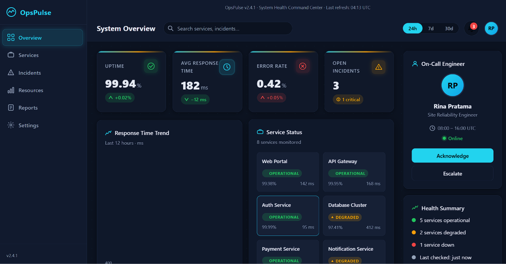

# OpsPulse – System Health Command Center

> A single-page, fully static IT operations dashboard built with HTML5 and CSS3 — no JavaScript, no frameworks, no external dependencies.

---

## Screenshot



---

## Features

| Component | Description |
|---|---|
| **Sidebar navigation** | Logo, 6 nav links, active state highlighted with cyan glow |
| **Top navigation bar** | Page title, search input, time-range buttons, notification bell with badge, user avatar |
| **4 KPI cards** | Uptime, Avg Response Time, Error Rate, Open Incidents — with delta chips and trend icons |
| **Service Status grid** | 8 services with Operational / Degraded / Down badges, uptime %, and latency |
| **Response Time Trend** | Pure-CSS bar chart of the last 12 hours with hover tooltips (no JavaScript) |
| **Incident Alerts** | 8 incidents with CSS-only severity filter tabs (All / Critical / High / Medium / Low) |
| **Resource Usage** | CPU, Memory, Disk, Network progress bars with threshold-coloured fills |
| **Recent Activity** | Chronological timeline of 6 operational events |
| **On-call Profile** | Engineer name, role, shift, online status, Acknowledge / Escalate buttons |

### Visual design
- Dark theme with CSS custom properties
- Glass-morphism cards (`backdrop-filter: blur`)
- Dotted grid background, cyan glow on active elements, gradient accent top line on KPIs
- Pulsing animated status dots (Operational / Down)
- Full print stylesheet — light on white, sidebar hidden

### Accessibility
- WCAG 2.1 AA colour contrast verified
- Single `<h1>`, logical `<h2>` heading hierarchy
- All landmarks have accessible names (`aria-label`)
- Skip-to-content link (visible on keyboard focus)
- Status and severity conveyed by text **and** shape, not colour alone
- `prefers-reduced-motion` suppresses all animations and transitions
- Explicit `:focus-visible` rings on every interactive element
- No `role="tab"` on `<label>` elements; no misleading `aria-pressed` on static buttons
- All SVG icons use `currentColor`; decorative ones are `aria-hidden="true"`

### Security
- Content Security Policy via `<meta http-equiv="Content-Security-Policy">`:  
  `default-src 'none'; style-src 'self'; img-src 'self' data:; base-uri 'none'; form-action 'none'`
- `<meta name="referrer" content="no-referrer">`
- Zero inline `style=""` attributes — all values moved to CSS utility classes
- Zero inline event handlers
- Zero external requests (no CDN, no fonts, no scripts)
- Favicon delivered as a `data:` URI (no network request)

---

## Tech Stack

| Layer | Choice |
|---|---|
| Markup | HTML5 — semantic elements (`<header>`, `<nav>`, `<main>`, `<section>`, `<article>`, `<aside>`, `<footer>`) |
| Styling | CSS3 — custom properties, Grid, Flexbox, `@keyframes`, `backdrop-filter`, `@media print` |
| JavaScript | **None** — filtering, tooltips, and navigation toggle are pure-CSS |
| Fonts | System font stack (`-apple-system`, `"Segoe UI"`, `system-ui`, `sans-serif`) |
| Icons | Inline SVG — no icon library |
| Data | Static dummy data — hardcoded in HTML |

---

## Project Structure

```
capstone-project/
├── index.html      # Main dashboard (716 lines)
├── style.css       # All styles, 7 sections (1 625 lines)
├── 404.html        # Friendly 404 page, same visual style
├── robots.txt      # Allows all crawlers
├── README.md       # This file
├── LICENSE         # MIT
├── .gitignore      # OS and editor artefacts
└── .editorconfig   # UTF-8, LF, 2-space indent
```

### CSS organisation (`style.css`)

| Section | Contents |
|---|---|
| 1 — Custom Properties | Design tokens: palette, layout, shapes, shadows, transitions |
| 1b — Keyframes | `pulse-ring` animation |
| 2 — Base / Reset | `box-sizing`, typography, `a`, `button`, `:focus-visible`, `.sr-only`, `.skip-link` |
| 3 — Layout | Body grid, main-wrapper grid |
| 4 — Components | 4a Mobile header · 4b Sidebar · 4c Topbar · 4d KPI cards · 4e Service grid · 4f Bar chart · 4g Incident alerts · 4h Resources · 4i Activity log · 4j On-call card · 4k Health summary · 4l Footer |
| 5 — Responsive | Breakpoints at 1024 px, 640 px, 360 px |
| 6 — Reduced Motion | `prefers-reduced-motion: reduce` |
| 7 — Print | `@media print` — light theme, hides chrome, `break-inside: avoid` |

---

## How to Run Locally

### Option 1 — Open directly (simplest)
```bash
# No build step needed
open index.html          # macOS
start index.html         # Windows
xdg-open index.html      # Linux
```

### Option 2 — VS Code Live Server
1. Install the **Live Server** extension in VS Code.
2. Right-click `index.html` → **Open with Live Server**.
3. The dashboard opens at `http://127.0.0.1:5500/index.html`.

### Option 3 — Python HTTP server
```bash
python3 -m http.server 8080
# then open http://localhost:8080
```

> **Note:** The Content Security Policy is delivered via a `<meta>` tag, so it is enforced in all three options. No server-side configuration is required.

---

## Accessibility & Security Notes

### WCAG 2.1 AA compliance
All text and interactive element colour combinations were verified against WCAG 2.1 Level AA contrast ratios (minimum 4.5 : 1 for normal text, 3 : 1 for large text). Key pairs:

| Pair | Ratio |
|---|---|
| `--text #E5EAF3` on `--bg #0B1220` | 15.9 : 1 |
| `--muted #94A3B8` on `--bg #0B1220` | 7.2 : 1 |
| `--primary #22D3EE` on `--bg #0B1220` | 11.9 : 1 |
| `#000` on `--primary #22D3EE` (active tab) | 12.5 : 1 |
| `#000` on `--accent #F59E0B` (High tab) | 8.0 : 1 |
| `#fff` on `--danger #EF4444` (badge, 11 px) | 4.6 : 1 ✓ |

### Content Security Policy
The `<meta>` CSP restricts all resource types to `'none'` by default, permitting only `style.css` (`style-src 'self'`) and the `data:` URI favicon (`img-src data:`). **Limitation:** a `<meta>` CSP is enforced after HTML parsing begins and cannot block `frame-ancestors`; prefer an HTTP `Content-Security-Policy` response header in production.

---

## Known Limitations

- **Static dummy data** — all values (uptime %, latency, incidents) are hardcoded in HTML. There is no live data feed, WebSocket connection, or API integration.
- **No persistent state** — the incident filter tab selection, time-range button active state, and all other UI state reset on page reload (no `localStorage`, no cookies).
- **No real monitoring** — OpsPulse is a visual prototype only. It does not connect to any infrastructure, alerting system, or metrics backend.
- **Single timezone** — timestamps are in UTC and are not adjusted for the viewer's local timezone.
- **Print layout** — tested on A4 landscape. Content may overflow on narrower paper sizes or with large system font sizes.
- **CSS-only filtering** — the incident filter uses `<input type="radio">` + `:checked` sibling selectors. Because there is no JavaScript, the active tab cannot expose `aria-selected` state; screen reader users receive the full list regardless of the visual filter.

---

## Built with IBM Bob

This project was developed end-to-end using **IBM Bob** (AI-assisted software engineering) following a structured **3-layer prompt** methodology:

### Layer 1 — Role & Context
> *"Act as a senior frontend engineer competing in the IBM University Education Capstone (IBM Bob track). You are building OpsPulse, a System Health Command Center dashboard for an IT operations team…"*

Establishing the persona and domain context up front aligned every subsequent generation towards production-quality IT tooling rather than generic UI patterns.

### Layer 2 — Task & Requirements
> *"Build a single-page, responsive dashboard with these 9 components: Sidebar navigation, Top navigation bar, 4 KPI cards, Service Status grid, Response Time Trend, Incident Alerts, Resource Usage, Recent Activity Log, On-call Profile card…"*

A precise, numbered component list gave Bob a concrete contract — each component had defined content, data shape, and layout position — eliminating ambiguity and enabling iterative refinement.

### Layer 3 — Constraints & Output
> *"Visual style: modern dark theme… HTML5 + CSS3 only. No JavaScript, no frameworks… Exactly two files: index.html and style.css…"*

Hard constraints prevented scope creep and forced elegant CSS-only solutions (pure-CSS bar chart tooltips, radio-based filtering, checkbox-based mobile nav).

### Iterative refinement passes
After the initial two-file generation, Bob was used for targeted improvement sprints:
1. **Visual polish** — glass cards, dotted grid, cyan glows, gradient KPI accent lines, pulsing status dots
2. **CSS-only filtering** — incident tabs built with hidden `<input type="radio">` + `:checked ~ sibling` selectors
3. **Accessibility audit** — 22 findings across WCAG, HTML validity, and cross-browser support
4. **Audit remediation** — all Critical and High findings fixed (duplicate landmarks, invalid ARIA roles, SVG `var()` attributes, missing skip link, etc.)
5. **Production metadata** — CSP, Open Graph, Twitter Card, SVG favicon, `404.html`, `robots.txt`
6. **Accessibility & resilience** — `prefers-reduced-motion`, `@media print`, shape indicators beyond color, focus-visible hardening
7. **Security & performance** — zero inline styles, zero external requests, all CSS custom properties exposed through classes

---

## License

MIT © 2026 — see [LICENSE](LICENSE) for full text.
